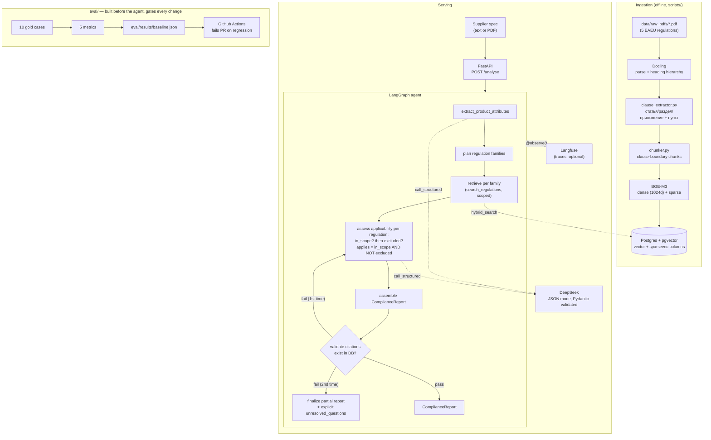

# Compliance Copilot

Multilingual agentic RAG system that maps Chinese supplier specifications to
Eurasian Economic Union (EAEU / ЕАЭС) certification requirements and returns
clause-level citations.

## The problem

An importer in Kazakhstan or Russia receives a specification sheet from a
Chinese supplier — usually a PDF in Chinese or broken English, listing
voltage, frequency, materials, wireless bands, intended use. Before that
product can be sold in the EAEU customs union it must comply with the
relevant technical regulations (технические регламенты), carry EAC marking,
and hold either a declaration or a certificate of conformity. Working out
which regulations apply, and which specific clauses within them, is slow
manual work currently done by paid consultants.

This system takes a supplier specification as input and returns: the
applicable technical regulations, the specific clauses that trigger, the
conformity assessment route required, and a citation — document ID, clause
path, and quoted span — for every claim. **An answer without a citation is a
bug, not a degraded response.** If the evidence isn't there, the system says
so rather than guessing.

v1 scope covers electronics, the highest-volume import category:

| Code | Regulation |
|---|---|
| ТР ТС 004/2011 | Safety of low-voltage equipment |
| ТР ТС 020/2011 | Electromagnetic compatibility |
| ТР ЕАЭС 037/2016 | Restriction of hazardous substances (RoHS) |
| ТР ТС 010/2011 | Safety of machinery and equipment |
| ТР ТС 008/2011 | Safety of toys |

The regulatory corpus is Russian. Supplier specs and queries may be Chinese,
English, or Russian — retrieval and the agent are both cross-lingual by
construction (BGE-M3 embeddings, no translation step).

## Architecture



**Layers**, `src/compliance_copilot/`:

| Package | Responsibility |
|---|---|
| `ingest/` | Docling PDF parsing, статья/пункт clause extraction, clause-boundary chunking |
| `retrieval/` | BGE-M3 embedding, hybrid dense+sparse search, reciprocal rank fusion, relevance floor |
| `agent/` | LangGraph pipeline, DeepSeek structured-output calls, the 4 tools |
| `db/` | SQLAlchemy models, pgvector setup |
| `schemas/` | Pydantic models shared across every layer — the citation constraint lives here |
| `api/` | FastAPI routers |

## How to run

Requires `uv`, Docker, and Docker Compose.

```bash
cp .env.example .env       # fill in DEEPSEEK_API_KEY; LANGFUSE_* optional
uv sync

# Bring up Postgres+pgvector (host port 5433 — see note below)
docker compose up -d db

# Ingest the corpus (real PDFs already committed in data/raw_pdfs/)
uv run python scripts/ingest_corpus.py
uv run python scripts/corpus_stats.py    # measured document/clause/chunk counts
uv run python scripts/load_corpus.py     # embeds with BGE-M3, writes to Postgres

# Verify
uv run pytest -m "not llm"               # fast, free — no DeepSeek calls
uv run pytest                            # full suite, needs DEEPSEEK_API_KEY
uv run ruff check .
uv run mypy --strict src scripts eval
uv run python eval/run_eval.py           # retrieval-only: fast, free, the CI gate
uv run python eval/run_eval_agent.py     # full agent: real DeepSeek calls, ~10 min
uv run python scripts/tune_retrieval.py  # sweep fusion_weight/top_k/relevance_floor

# Run the API
docker compose up -d --build
curl http://localhost:8000/health
```

Postgres publishes on host port **5433**, not 5432 — this machine already had
a native Postgres on the default port. Only the host-side mapping differs;
`docker compose`'s internal network (`api` → `db:5432`) is unaffected.

### API

| Endpoint | Description |
|---|---|
| `POST /analyse` | `spec_text` (form field) or `file` (PDF upload) → `ComplianceReport` |
| `GET /documents` | Corpus inventory: every ingested regulation and its clause count |
| `GET /clauses/{clause_id}` | Resolves a citation to full text + document-order neighbors |
| `GET /health` | Liveness check |

```bash
curl -X POST http://localhost:8000/analyse \
  -F "spec_text=Product: LED desk lamp, 5V DC via USB-C adapter, 100-240V AC 50/60Hz"
```

## Measured results

### Corpus (Phase 2)

| Regulation | Clauses | Chunks |
|---|---:|---:|
| ТР ТС 004/2011 | 87 | 87 |
| ТР ТС 020/2011 | 101 | 102 |
| ТР ЕАЭС 037/2016 | 100 | 100 |
| ТР ТС 010/2011 | 268 | 274 |
| ТР ТС 008/2011 | 118 | 122 |
| **Total** | **674** | **685** |

All 5 documents, all Russian. Re-run `scripts/corpus_stats.py` after any
ingestion change — this table should match its output, not be hand-edited.
Provenance (including why the PDFs are locally-rendered from a mirror rather
than the original binary — the primary hosts were unreachable from this
environment) is in [`data/sources.md`](data/sources.md).

### Retrieval and eval harness (Phases 3–5)

10 hand-labelled gold cases in `eval/cases/`, scored against 5 metrics
(`eval/metrics.py`), retrieval-only (no agent in the loop) so the number
reflects retrieval quality specifically. Parameters (`fusion_weight`,
`top_k`, `relevance_floor`) were tuned by sweeping against this harness
(`scripts/tune_retrieval.py`), not by intuition — twice: once before a real
bug fix, once after, since the fix changed which config was actually best:

| Metric | Original (top_k=10, floor=0.35) | Current (fusion=0.5, top_k=10, floor=0.45) |
|---|---:|---:|
| retrieval_recall_at_k | 0.125 | 0.250 |
| citation_precision | 0.560 | 0.580 |
| regulation_set_f1 | 0.726 | 0.712 |
| false_positive_rate | 0.524 | 0.571 |
| abstention_accuracy | 0.000 | 0.000 |

`eval/run_eval.py` writes `eval/results/latest.json` and compares it against
the committed `eval/results/baseline.json`, exiting non-zero on a regression
beyond tolerance — this is the actual CI merge gate, not a report nobody
reads.

**Two of those five numbers do not mean what their names suggest at this
layer**, and reading them as system behaviour is a mistake worth calling out
explicitly, because the table above invites it. Retrieval makes no
applicability decision — it returns the k nearest chunks, full stop. So
`false_positive_rate = 0.571` counts "a clause from a `must_not_return`
regulation appeared in the top-10", not "the system claimed that regulation
applies"; and `abstention_accuracy = 0.000` only says nothing cleared the
relevance floor, which no floor value can fix. Measured on this corpus the
insufficient-information cases score *higher* than a real product spec does —
case_007 (a bare SKU, zero technical content) spans 0.509–0.629 while case_004
(a fully specified night light) spans 0.466–0.539 — so any floor that silences
case_007 deletes case_004 outright. Cosine similarity measures topical
overlap, not whether the spec carried enough information to decide; that is a
property of the embedding space, not a tuning mistake.

Both are measured properly by `eval/run_eval_agent.py`, which runs the same
gold cases through the full agent and scores the same five metrics against
findings and real citations (separate baseline, `agent_baseline.json`; real
DeepSeek calls, minutes per run, so it is not the per-push CI gate).
`eval/metrics.py` holds one copy of each metric definition, parameterized over
a `Prediction` protocol that both harnesses satisfy.

### Agent-level metrics (`eval/run_eval_agent.py`)

Same 10 gold cases, same 5 metrics, scored on what the agent concluded:

| Metric | Retrieval layer | Agent, first run | Agent, after fixes |
|---|---:|---:|---:|
| retrieval_recall_at_k | 0.250 | 0.312 | **0.750** |
| citation_precision | 0.580 | 1.000 | **1.000** |
| regulation_set_f1 | 0.712 | 0.700 | **0.975** |
| false_positive_rate | 0.571 | 0.000 | **0.000** |
| abstention_accuracy | 0.000 | 1.000 | **1.000** |

The agent column is not a retrieval improvement — it is a different question
being asked. The two metrics that were structurally unmeasurable at the
retrieval layer come out clean from the first run onward: zero forbidden
regulations asserted across all ten cases (including both plausible-but-wrong
traps), and both insufficient-information cases declined. Citation precision is
1.000 because every clause the agent cites belongs to a regulation that
genuinely applies.

**The first agent run's `regulation_set_f1` of 0.700 was the useful finding.**
The errors were **false negatives, not false positives** — the agent never
over-triggered, it under-triggered on two cases, and the harness localized each
to a specific graph node with a distinct root cause:

- **case_001** (hand-crank coffee grinder, expects ТР ТС 010/2011) failed at
  the **planner**, which excluded machinery safety before retrieval ever ran:
  "It is not a machine or equipment in the sense of ТР ТС 010/2011, which
  typically applies to powered..." The planner judges scope from a one-line
  description plus the model's own priors, having seen no regulation text yet,
  and 010/2011's description was five words: "safety of machines and/or
  equipment". Confirmed to be prompt rather than model capability by
  experiment — same model, same `temperature=0`, expanded description, case
  passes. Fixed by stating that scope does not depend on a power source.
- **case_010** (plush teddy bear, expects ТР ТС 008/2011) failed at
  **assess_applicability**, where the agent was arguably behaving correctly.
  Its own reasoning: "The general hygiene and material requirements of TR TS
  008/2011 *would* apply, but the cited clauses provided do not include those
  general requirements. Therefore, based on the given clauses, the regulation
  does not apply." Retrieval had handed it Приложение 1 пункт 17, "3.6.
  Электрические свойства", and Статья 1 **пункт 2** (the exclusions list) — but
  not Статья 1 **пункт 1**, the clause that states what the regulation covers.
  The agent refused to assert what it had no citation for, which is the design
  constraint working as intended.

The second one is the more interesting fix, because the bug was not in the
reasoning. Applicability is *defined* by the scope clause, so an assessor asked
"does this regulation apply" needs that clause in evidence every time rather
than only when ranking happens to surface it. `hybrid_search` now takes an
opt-in `ensure_scope_clause` flag (used by the agent's retrieve node, not by the
retrieval baseline) that appends it past both the relevance floor and the top_k
cut, scored with its real cosine similarity rather than a stub. The clause is
located structurally, not hardcoded: every EAEU regulation opens by declaring
what it covers ("...распространяется на..."), and taking the earliest such
clause in document order resolves the five regulations to exactly the five
scope clauses the gold cases name. `tests/test_retrieval.py` guards both the
miss and the fix.

Fixing under-triggering bought no over-triggering: `false_positive_rate` stayed
at 0.000 and abstention at 1.000, so the traps still hold. case_006 improved as
a side effect (it had been dropping ТР ТС 020/2011). One case still misses:
case_009 does not surface ТР ТС 004/2011.

Read plainly, on these 10 cases the agent now asserts 17 of the 18 applicable
regulations with zero false assertions — 100% precision (17/17), 94% recall,
9 of 10 answers fully correct. Those are small-sample numbers: at n=10 the 95%
confidence interval on "fully correct" runs from 60% to 98%, so treat them as
evidence the known defects are fixed, not as a measured accuracy claim.

### Exclusions, and why applicability is two questions

12 further gold cases (`case_011`–`case_022`) probe the other half of scope:
products a regulation's positive scope reaches but that it then carves back out
by name. That set found a different class of defect from everything above, and
fixing it took three attempts worth recording, because the first two are the
kind of thing that looks right and is not.

**Attempt 1 — the candidate clauses were being truncated.** The assessor was
handed `hit.text[:500]`. ТР ЕАЭС 037/2016's exclusions are a single
1290-character clause enumerating а)–к), so the model saw the two exclusions
that fit inside 500 characters and none of the eight that did not — then
affirmed applicability for electric toys, used goods, medical devices,
measuring instruments, photovoltaics and vehicle equipment, every one of which
that clause excludes by name. The correlation was exact: both cases whose
exclusion sub-item fell inside the cut passed, all six whose sub-item fell
outside it failed. Not a reasoning failure at all — the text was never shown.
Raised to 2500 (p99 clause length is 2255); 21% of the corpus had been silently
truncated.

**Attempt 2 — teaching one prompt to weigh both halves.** Adding exclusion
instructions to the single applicability prompt swung the agent the other way:
false positives went to zero, but recall fell from 97% to 72% as ТР ЕАЭС
037/2016 started disappearing from products it genuinely covers, and the
old 10 cases regressed from 90% to 67%. It also made the model verbose enough
to blow a 43 KB response past the output limit mid-string, failing one case
outright. A prompt asked to look for reasons a regulation applies misses
exclusions; the same prompt rewritten to look for exclusions over-applies them.
That balance could not be struck by wording.

**Attempt 3 — two one-directional questions.** `assess_applicability` now makes
two calls per regulation — "does the positive scope reach this product?" and,
only if so, "is it carved back out?" — and combines them in code as
`applies = in_scope and not excluded`. Neither prompt has a balance to lose.
This restored what attempt 2 broke (old cases back to 90%, recall back to 97%,
no output-limit failure) without reintroducing the exclusion blindness.

Both halves of the scope statement are supplied structurally rather than left
to ranking, for the same reason the positive half was: they are lexically near
identical — the exclusion differs by one "не" in a clause that can run past
1600 characters — so embedding similarity cannot prefer one over the other.

**Measured honestly, attempt 3 is indistinguishable from attempt 1 on
aggregate.** Both score 68% of cases fully correct at the same precision and
recall; attempt 3 changed which cases fail rather than how many. Repeating the
run three times on unchanged code then showed why that comparison could never
have settled it: the fully-correct rate swings 59–68% by itself, so the two
configurations differ by less than the measurement's own noise. Attempt 3's
case for shipping is structural rather than numeric — no prompt left holding
two opposed instructions, one fewer way to fail — plus it removed the
output-limit failure attempt 2 introduced. See the noise-floor entry under
Limitations for what the harness can and cannot resolve.

Three real bugs were found and fixed while working with this harness, not
assumed away:

- **`fusion_weight` was silently inert.** `hybrid_search` defaulted a chunk's
  `dense_score` to `0.0` whenever it was found only via sparse search — but a
  chunk can have a real, floor-clearing dense similarity (e.g. 0.45) while
  still ranking outside dense search's own independent top_k. The old code
  discarded that real value and floor-filtered the chunk regardless of
  `fusion_weight`, which is what made every `fusion_weight` from 0.0 to 1.0
  produce byte-identical metrics at the shipped floor. Fixed with a
  supplemental targeted lookup for exactly the chunks this affected — verified
  `fusion_weight` now changes results, and `recall_at_k` doubled (0.125 →
  0.250) once genuinely relevant chunks stopped being wrongly discarded.
- **A realistic full spec retrieved *worse* than a bare word.** The originally
  reported "weak lead retrieval" limitation turned out to be a symptom of a
  bigger problem: embedding an entire prose spec as one query dilutes a
  specific fact (e.g. "contains lead") across everything else in the text —
  a realistic spec mentioning lead content retrieved zero lead-related
  clauses in the top 10, worse than the bare word "lead" alone ever did.
  Fixed by having the agent's retrieval step query with the compact,
  already-extracted `ProductAttributes` JSON instead of raw spec text —
  verified to match or beat spec-text retrieval on every case checked,
  including ones that already worked. The residual weakness for the bare
  word "铅"/"lead" with zero surrounding context is a genuine BGE-M3
  embedding-space characteristic, not fixable by retrieval mechanics, and not
  the practical failure mode anyway (`tests/test_retrieval.py`).
- **abstention_accuracy = 0.0 at the retrieval layer** — a relevance floor
  can only measure topical similarity, not information sufficiency. A query
  that just says "no technical details provided" still scores 0.56–0.59
  cosine similarity against clauses *about* documentation requirements —
  related vocabulary, wrong reason. This is exactly why the agent has a
  separate, deterministic check (`ProductAttributes.is_empty`) instead of
  relying on the retrieval threshold — and it works: verified live, the full
  agent correctly abstains on the same case this metric is measuring.

Cross-lingual retrieval — the hard requirement — was verified against the
real corpus: Chinese queries for cadmium (镉) and hexavalent chromium (六价铬),
and an English query for "low voltage equipment," each correctly retrieve the
matching Russian clause at or near top-1 (`tests/test_retrieval.py`).

### Agent (Phase 5)

Verified live end to end against the real DeepSeek API and real DB — not
mocked (`tests/test_agent.py`, `tests/test_api.py`):

- A real spec produces findings with valid, DB-checked citations.
- A vague spec abstains: empty findings, confidence 0.0, explicit
  `unresolved_questions`.
- A night-light spec with child-adjacent marketing ("sold in the children's
  bedroom decor section") correctly excludes toy safety at the *planning*
  stage — the model reasons about function, not keyword proximity.
- The validate → retry → partial-report path is tested against a synthetic
  bad state (a real LLM won't organically produce an invalid citation, since
  `assess_applicability` already rejects out-of-set clause_ids before they
  reach the report — so this path is exercised deliberately, not left
  unverified).

Four real defects were found by testing live and fixed, not assumed away —
worth naming because they're the kind of thing that only shows up when you
actually run the system:

- DeepSeek initially echoed the JSON *schema* back as its answer instead of
  producing an instance of it — the first prompt phrasing was genuinely
  ambiguous. Fixed.
- The planner reasoned that toy safety "is for toys with electrical or
  mechanical features" and returned an empty report for a plain plush teddy
  bear — a real EAEU toy-safety regulation covers all toys regardless of
  power source. The regulation's one-line description in the prompt was too
  terse; rewritten to be explicit. The planner half of that fix held, but the
  case kept failing end to end — the agent harness later reproduced an empty
  report for the same teddy bear (case_010) deterministically, with the failure
  one node downstream in `assess_applicability`. Root-caused to a retrieval
  miss rather than a reasoning error and fixed separately; see the
  agent-harness section above. Worth keeping both halves on the record: the
  first fix was verified by re-running the one case it addressed, which is
  exactly the kind of check that confirms a symptom is gone without noticing
  the same case still fails for an adjacent reason.
- A test failed intermittently on an unambiguous case — DeepSeek's default
  temperature let identical input reach different categorical conclusions
  across runs. Pinned `temperature=0`; the previously-flaky test then passed
  4/4 in a row. For a compliance system, consistency on identical input
  matters as much as correctness.
- The agent concluded low-voltage safety didn't apply to an LED lamp by
  reasoning about the lamp's 5V DC *output* rather than its 100-240V AC
  *adapter* — the actual equipment in scope. Fixed by making both the
  ТР ТС 004/2011 prompt description and the general applicability-assessment
  prompt explicit that a product can bundle multiple distinct electrical
  components (device, adapter, battery, ...) and each should be assessed
  separately. Verified live, consistent 3/3 on repeated runs; regression
  assertion added to the existing test for this exact case.

## Limitations

Stated plainly, not buried. Three items that were listed here before —
`fusion_weight` inertness, weak lead retrieval, and the adapter-vs-device
voltage gap — were found, root-caused, fixed, and verified live; see the
Retrieval and Agent sections above for what was actually wrong and what the
fix was. What's left:

- **The agent is not deterministic, and the noise floor sets a limit on what
  the harness can resolve.** `temperature=0` bounds sampling variance without
  eliminating it — DeepSeek is MoE and provider-side routing varies with
  batching — so the earlier "pinned temperature=0, then passed 4/4" reduced
  flakiness rather than removing it. Measured over three identical runs of all
  22 cases on unchanged code:

  | Metric | Spread over 3 runs |
  |---|---|
  | retrieval_recall_at_k | 0.417 / 0.417 / 0.417 — exact |
  | abstention_accuracy | 1.000 / 1.000 / 1.000 — exact |
  | recall (regulations found) | 96.9% three times — exact |
  | regulation_set_f1 | 0.753 – 0.770 (±0.017) |
  | false_positive_rate | 0.039 – 0.059 (±0.020) |
  | precision (assertions correct) | 77.5% – 81.6% (±4 pts) |
  | **cases fully correct** | **59% – 68% (±9 pts)** |

  Two of 22 cases accounted for all of it (case_006, case_012), both on
  genuinely borderline verdicts. Because identical input reaching different
  conclusions is a product defect in a compliance system and not only a
  measurement problem, the assessor now decides each of its two questions by
  majority vote (`_majority_verdict`). Re-measured the same way, three runs
  with voting:

  | Metric | Without voting | With voting |
  |---|---|---|
  | unstable cases | 2 of 22 | 1 of 22 |
  | cases fully correct | 13 / 14 / 15 | **14 / 14 / 14** |
  | regulation_set_f1 spread | 0.017 | **0.007** |
  | citation_precision spread | 0.029 | **0.012** |
  | wall clock per run | ~5:10–5:41 | ~5:24–5:36 |

  The headline metric became deterministic across three runs, and the mean did
  not move (14 either way) — voting buys consistency, not accuracy, which is
  what it was for. Two samples run concurrently and a third is fetched only to
  break a tie, so latency stays near a single call and the usual cost is two
  calls rather than three.

  What remains: case_012 still varies, and case_006's stabilising cannot be
  fully credited to voting — its flip was traced to the planner, which the
  vote does not cover, so three quiet runs may just mean a rare event did not
  recur. Voting the planner is the cheaper of the two to add if that matters
  (one call per case, against two per regulation).

  Independent of noise, `regulation_set_f1` and recall remain the metrics to
  compare configurations on; *cases fully correct* was too coarse to judge a
  change by even before voting, and the harness's 0.05 default tolerance sits
  comfortably above f1's residual spread.
- **Prompt quality has not been extensively tuned beyond the specific gaps
  found and fixed above.** Real cases were tested and real bugs were caught
  this way, but that's a different thing from a systematic prompt-tuning
  pass — more reasoning gaps than the ones already found likely exist.
- **Ranked retrieval recall is still moderate (0.250) against the gold anchor
  clauses**, even after doubling it by fixing the fusion_weight bug. What the
  agent ends up citing is better than that (0.750) — but only because the scope
  clause is now supplied structurally rather than by ranking, which covers the
  single most important clause per regulation and nothing else. Regulation-level
  signal stays stronger than clause-level precision: the system points at the
  right regulation reliably; beyond the scope clause, the specific пункт it
  cites may not be the one an expert would reach for first.
- **No Langfuse trace has actually been inspected, and the credentials in
  `config.py` never reach the SDK.** `settings.langfuse_public_key` /
  `langfuse_secret_key` are declared but read by nothing — `@observe()` relies
  on the SDK self-configuring from `LANGFUSE_*` environment variables. Under
  `docker compose` that works by accident, since `env_file` exports `.env` as
  real env vars; running uvicorn natively it does not, because
  pydantic-settings loads `.env` into the `Settings` object without touching
  `os.environ`, so tracing silently disables itself ("Langfuse client
  initialized without public_key. Client will be disabled") even with the keys
  filled in. Confirmed the run completes fine in that state — the graceful
  degradation claim holds — but the trace tree's actual usefulness remains
  unverified, and the settings fields are dead code until something bridges
  them to the SDK.
- **The corpus PDFs are not the government's original files.** The primary
  hosts (docs.cntd.ru, eec.eaeunion.org) were unreachable from this
  environment; the text is authentic (pulled from a reachable mirror,
  verified against the real decision numbers) but re-rendered into PDF
  locally. See `data/sources.md`.
- **CI has never actually run.** The GitHub Actions workflow is written and
  its exact command sequence was verified locally against a from-scratch
  database, but this repository has no GitHub remote yet — the workflow has
  not executed in GitHub's environment.
- **No Alembic migrations.** Schema is created via `Base.metadata.create_all`
  on startup. Fine for a project with no migration history yet; will need
  real migration tooling before the schema changes in production.
- **The Docker image is heavier than it needs to be** — 5.01 GB. It bundles
  the full ingestion/retrieval stack (Docling, PyTorch, BGE-M3) even though the
  API container's own endpoints don't run ingestion. Worth splitting into an
  optional dependency group if image size becomes a real problem. The CUDA half
  of this is fixed: torch and torchvision are pinned to PyTorch's CPU-only
  index, and `grep -c nvidia uv.lock` is now 0 (it was 73). That pin needs both
  an `explicit = true` `[[tool.uv.index]]` *and* torch/torchvision listed as
  direct `[project.dependencies]` — uv applies `[tool.uv.sources]` only to
  direct dependencies, so while they were merely transitive (via
  flagembedding/docling) the redirect was silently ignored and Linux resolution
  kept pulling the multi-GB CUDA stack.
- **The API container needs materially more RAM than Docker's default
  allocation.** Loading BGE-M3 on the first `/analyse` OOM-kills the container
  (exit 137) at Docker Desktop's ~2 GiB default — from the client side this
  looks like a request that hangs and never returns, not an error. Raise the
  Docker VM's memory before running the API in a container; running uvicorn on
  the host instead sidesteps it.
- **The model cache isn't persisted across container recreation.** Nothing
  mounts `~/.cache/huggingface`, so a recreated API container re-downloads
  BGE-M3's ~4.3 GB of weights on its first request. A volume mount would fix
  it; the host-side run reuses the existing cache and starts immediately.
- **v1 scope is electronics only**, 5 regulations. No conformity-assessment
  workflow beyond stating the route; no handling of amendments/versioning in
  the regulations themselves; no multi-product batch analysis.

## Status

- [x] Phase 1 — Foundation (schemas, config, containerized API skeleton)
- [x] Phase 2 — Ingestion (Docling parsing, clause extraction, chunking)
- [x] Phase 3 — Hybrid retrieval (BGE-M3 dense+sparse, RRF fusion, relevance floor)
- [x] Phase 4 — Evaluation harness (10 gold cases, 5 metrics, pre-agent baseline)
- [x] Phase 5 — Agent loop (LangGraph pipeline, structured outputs, validation retry, tuned retrieval)
- [x] Phase 6 — API and CI (4 endpoints, GitHub Actions with eval gate)
