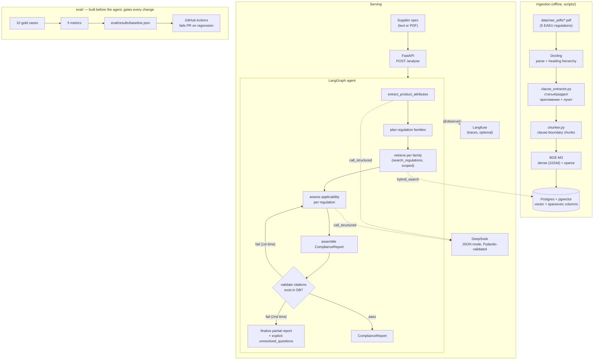

# Compliance Copilot

Multilingual agentic RAG system that maps Chinese supplier specifications to
Eurasian Economic Union (EAEU / ЕАЭС) certification requirements and returns
clause-level citations.

## The problem

An importer in Kazakhstan or Russia receives a specification sheet from a
Chinese supplier — usually a PDF in Chinese or broken English, listing
voltage, frequency, materials, wireless bands, intended use. Before that
product can be sold in the EAEU customs union it must comply with the
relevant technical regulations (технические регламенты), carry EAC marking,
and hold either a declaration or a certificate of conformity. Working out
which regulations apply, and which specific clauses within them, is slow
manual work currently done by paid consultants.

This system takes a supplier specification as input and returns: the
applicable technical regulations, the specific clauses that trigger, the
conformity assessment route required, and a citation — document ID, clause
path, and quoted span — for every claim. **An answer without a citation is a
bug, not a degraded response.** If the evidence isn't there, the system says
so rather than guessing.

v1 scope covers electronics, the highest-volume import category:

| Code | Regulation |
|---|---|
| ТР ТС 004/2011 | Safety of low-voltage equipment |
| ТР ТС 020/2011 | Electromagnetic compatibility |
| ТР ЕАЭС 037/2016 | Restriction of hazardous substances (RoHS) |
| ТР ТС 010/2011 | Safety of machinery and equipment |
| ТР ТС 008/2011 | Safety of toys |

The regulatory corpus is Russian. Supplier specs and queries may be Chinese,
English, or Russian — retrieval and the agent are both cross-lingual by
construction (BGE-M3 embeddings, no translation step).

## Architecture



**Layers**, `src/compliance_copilot/`:

| Package | Responsibility |
|---|---|
| `ingest/` | Docling PDF parsing, статья/пункт clause extraction, clause-boundary chunking |
| `retrieval/` | BGE-M3 embedding, hybrid dense+sparse search, reciprocal rank fusion, relevance floor |
| `agent/` | LangGraph pipeline, DeepSeek structured-output calls, the 4 tools |
| `db/` | SQLAlchemy models, pgvector setup |
| `schemas/` | Pydantic models shared across every layer — the citation constraint lives here |
| `api/` | FastAPI routers |

## How to run

Requires `uv`, Docker, and Docker Compose.

```bash
cp .env.example .env       # fill in DEEPSEEK_API_KEY; LANGFUSE_* optional
uv sync

# Bring up Postgres+pgvector (host port 5433 — see note below)
docker compose up -d db

# Ingest the corpus (real PDFs already committed in data/raw_pdfs/)
uv run python scripts/ingest_corpus.py
uv run python scripts/corpus_stats.py    # measured document/clause/chunk counts
uv run python scripts/load_corpus.py     # embeds with BGE-M3, writes to Postgres

# Verify
uv run pytest -m "not llm"               # fast, free — no DeepSeek calls
uv run pytest                            # full suite, needs DEEPSEEK_API_KEY
uv run ruff check .
uv run mypy --strict src scripts eval
uv run python eval/run_eval.py           # score against the committed baseline
uv run python scripts/tune_retrieval.py  # sweep fusion_weight/top_k/relevance_floor

# Run the API
docker compose up -d --build
curl http://localhost:8000/health
```

Postgres publishes on host port **5433**, not 5432 — this machine already had
a native Postgres on the default port. Only the host-side mapping differs;
`docker compose`'s internal network (`api` → `db:5432`) is unaffected.

### API

| Endpoint | Description |
|---|---|
| `POST /analyse` | `spec_text` (form field) or `file` (PDF upload) → `ComplianceReport` |
| `GET /documents` | Corpus inventory: every ingested regulation and its clause count |
| `GET /clauses/{clause_id}` | Resolves a citation to full text + document-order neighbors |
| `GET /health` | Liveness check |

```bash
curl -X POST http://localhost:8000/analyse \
  -F "spec_text=Product: LED desk lamp, 5V DC via USB-C adapter, 100-240V AC 50/60Hz"
```

## Measured results

### Corpus (Phase 2)

| Regulation | Clauses | Chunks |
|---|---:|---:|
| ТР ТС 004/2011 | 87 | 87 |
| ТР ТС 020/2011 | 101 | 102 |
| ТР ЕАЭС 037/2016 | 100 | 100 |
| ТР ТС 010/2011 | 268 | 274 |
| ТР ТС 008/2011 | 118 | 122 |
| **Total** | **674** | **685** |

All 5 documents, all Russian. Re-run `scripts/corpus_stats.py` after any
ingestion change — this table should match its output, not be hand-edited.
Provenance (including why the PDFs are locally-rendered from a mirror rather
than the original binary — the primary hosts were unreachable from this
environment) is in [`data/sources.md`](data/sources.md).

### Retrieval and eval harness (Phases 3–5)

10 hand-labelled gold cases in `eval/cases/`, scored against 5 metrics
(`eval/metrics.py`), retrieval-only (no agent in the loop) so the number
reflects retrieval quality specifically. `top_k` was tuned by sweeping
against this harness (`scripts/tune_retrieval.py`), not by intuition:

| Metric | Before tuning (top_k=10) | After (top_k=5, current) |
|---|---:|---:|
| retrieval_recall_at_k | 0.125 | 0.125 |
| citation_precision | 0.560 | 0.580 |
| regulation_set_f1 | 0.726 | 0.757 |
| false_positive_rate | 0.524 | 0.190 |
| abstention_accuracy | 0.000 | 0.000 |

`eval/run_eval.py` writes `eval/results/latest.json` and compares it against
the committed `eval/results/baseline.json`, exiting non-zero on a regression
beyond tolerance — this is the actual CI merge gate, not a report nobody
reads.

Two results worth understanding, not just citing:

- **abstention_accuracy = 0.0 at the retrieval layer** — a relevance floor
  can only measure topical similarity, not information sufficiency. A query
  that just says "no technical details provided" still scores 0.56–0.59
  cosine similarity against clauses *about* documentation requirements —
  related vocabulary, wrong reason. This is exactly why the agent has a
  separate, deterministic check (`ProductAttributes.is_empty`) instead of
  relying on the retrieval threshold — and it works: verified live, the full
  agent correctly abstains on the same case this metric is measuring.
- **fusion_weight is currently inert** at the shipped `relevance_floor=0.35`:
  every value from 0.0 to 1.0 produced byte-identical eval metrics. Traced to
  a real mechanism, not a bug in the sweep — the floor checks `dense_score`
  specifically, so a chunk sparse search favors but dense search doesn't
  independently rank has `dense_score=0` and gets filtered regardless of
  weight. Confirmed by re-sweeping at `floor=0.0`, where fusion_weight changed
  every metric. Documented in `config.py` for whoever revisits the floor's
  dense-only anchoring.

Cross-lingual retrieval — the hard requirement — was verified against the
real corpus: Chinese queries for cadmium (镉) and hexavalent chromium (六价铬),
and an English query for "low voltage equipment," each correctly retrieve the
matching Russian clause at or near top-1 (`tests/test_retrieval.py`). A
fourth pair (lead: 铅/lead → Свинец) is measurably weaker — real similarity
(cosine ~0.38–0.43) that doesn't outrank corpus noise for this short, common
word. Reported, not hidden.

### Agent (Phase 5)

Verified live end to end against the real DeepSeek API and real DB — not
mocked (`tests/test_agent.py`, `tests/test_api.py`):

- A real spec produces findings with valid, DB-checked citations.
- A vague spec abstains: empty findings, confidence 0.0, explicit
  `unresolved_questions`.
- A night-light spec with child-adjacent marketing ("sold in the children's
  bedroom decor section") correctly excludes toy safety at the *planning*
  stage — the model reasons about function, not keyword proximity.
- The validate → retry → partial-report path is tested against a synthetic
  bad state (a real LLM won't organically produce an invalid citation, since
  `assess_applicability` already rejects out-of-set clause_ids before they
  reach the report — so this path is exercised deliberately, not left
  unverified).

Two real defects were found by testing live and fixed, not assumed away —
worth naming because they're the kind of thing that only shows up when you
actually run the system:

- DeepSeek initially echoed the JSON *schema* back as its answer instead of
  producing an instance of it — the first prompt phrasing was genuinely
  ambiguous. Fixed.
- The planner reasoned that toy safety "is for toys with electrical or
  mechanical features" and returned an empty report for a plain plush teddy
  bear — a real EAEU toy-safety regulation covers all toys regardless of
  power source. The regulation's one-line description in the prompt was too
  terse; rewritten to be explicit. Verified live afterward.

One reasoning gap is left visible rather than patched over: on a live run,
the agent concluded low-voltage safety didn't apply to an LED lamp by
reasoning about the lamp's 5V DC *output* rather than its 100-240V AC
*adapter* — the actual equipment in scope. That's a prompt-quality
limitation for future iteration, not a code defect.

## Limitations

Stated plainly, not buried:

- **Prompt quality has known gaps.** The adapter-vs-device voltage reasoning
  gap above is real and unresolved. This system has not been extensively
  prompt-tuned; it has been built correctly (structured outputs, citation
  validation, retry-once-then-fail-loud) and tested against real cases, which
  is a different thing from "tuned for accuracy."
- **Retrieval recall is low (0.125) against the gold anchor clauses.**
  Regulation-level signal (which regulations apply) is much stronger
  (F1 0.757) than clause-level precision. The system will point you at the
  right regulation reliably; the exact clause it cites may not always be the
  single most canonical one a human expert would pick first.
- **fusion_weight tuning is currently theoretical.** See above — it doesn't
  move any measured metric at the shipped relevance floor. The dense channel
  is carrying essentially all the useful signal right now.
- **No Langfuse trace has actually been inspected.** Tracing is wired
  (`@observe()`) and confirmed to degrade gracefully without credentials, but
  this environment has never had `LANGFUSE_PUBLIC_KEY`/`SECRET_KEY` set, so
  the trace tree's actual usefulness is unverified.
- **The corpus PDFs are not the government's original files.** The primary
  hosts (docs.cntd.ru, eec.eaeunion.org) were unreachable from this
  environment; the text is authentic (pulled from a reachable mirror,
  verified against the real decision numbers) but re-rendered into PDF
  locally. See `data/sources.md`.
- **CI has never actually run.** The GitHub Actions workflow is written and
  its exact command sequence was verified locally against a from-scratch
  database, but this repository has no GitHub remote yet — the workflow has
  not executed in GitHub's environment.
- **No Alembic migrations.** Schema is created via `Base.metadata.create_all`
  on startup. Fine for a project with no migration history yet; will need
  real migration tooling before the schema changes in production.
- **The Docker image is heavier than it needs to be.** It bundles the full
  ingestion/retrieval stack (Docling, PyTorch, BGE-M3) even though the API
  container's own endpoints don't run ingestion. On Linux/ARM64 this also
  pulls unused NVIDIA CUDA packages (no CPU-only wheel available for that
  platform). Worth splitting into an optional dependency group if image size
  becomes a real problem.
- **v1 scope is electronics only**, 5 regulations. No conformity-assessment
  workflow beyond stating the route; no handling of amendments/versioning in
  the regulations themselves; no multi-product batch analysis.

## Status

- [x] Phase 1 — Foundation (schemas, config, containerized API skeleton)
- [x] Phase 2 — Ingestion (Docling parsing, clause extraction, chunking)
- [x] Phase 3 — Hybrid retrieval (BGE-M3 dense+sparse, RRF fusion, relevance floor)
- [x] Phase 4 — Evaluation harness (10 gold cases, 5 metrics, pre-agent baseline)
- [x] Phase 5 — Agent loop (LangGraph pipeline, structured outputs, validation retry, tuned retrieval)
- [x] Phase 6 — API and CI (4 endpoints, GitHub Actions with eval gate)
